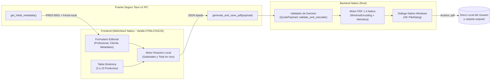

# Arquitectura Técnica y Decisiones de Diseño — Tally

**Proyecto:** Tally — Generador de Presupuestos en PDF  
**Desarrolladora:** Victoria Sanjurjo  
**Versión:** 1.0.0  
**Tecnologías base:** Rust (Edición 2021) + Tauri v2 + HTML5 / CSS3 / Vanilla JavaScript (ES2023) + Windows MSIX  

---

## 1. Visión General y Principios Rectores

**Tally** fue concebido bajo cinco requisitos arquitectónicos innegociables solicitados para el proyecto:

1. **Cero dependencias pesadas:** No se utilizan frameworks de frontend (React, Vue, Angular, Tailwind) ni bundlers complejos (Webpack, Vite), ni motores pesados de composición tipográfica o renderizado externo (como Chromium embebido duplicado, wkhtmltopdf o librerías con decenas de dependencias).
2. **Privacidad absoluta (100% Local):** La aplicación no requiere registro, no tiene cuentas de usuario, no incluye suscripciones ni pasarelas de pago, y **no recopila telemetría ni métricas del sistema**. Su política de seguridad de contenido (`CSP`) bloquea cualquier origen externo (`default-src 'self'`).
3. **Regla estricta de productos (3 a 10 ítems):** Tanto la interfaz gráfica como el validador de dominio en el backend de Rust garantizan que un presupuesto contenga entre **3 y 10 productos o servicios**.
4. **Cálculo reactivo instantáneo:** Al modificar la cantidad o el precio unitario de cualquier fila, el subtotal correspondiente y el total general se recalculan en tiempo real sin latencia.
5. **Generación PDF profesional y empaquetado MSIX:** El documento PDF final se construye nativamente en Rust en memoria y se guarda mediante el cuadro de diálogo nativo de Windows, además de empaquetar toda la solución en un instalador `.msix` firmado digitalmente por **Victoria Sanjurjo**.

---

## 2. Diagrama de Arquitectura

---

## 3. Justificación de Dependencias (Por qué se eligió cada librería)

En cumplimiento estricto de la regla de **no utilizar dependencias pesadas**, el archivo `src-tauri/Cargo.toml` incluye únicamente los crates mínimos indispensables:

| Crate | Versión | Propósito y Justificación Técnica |
| :--- | :--- | :--- |
| `tauri` / `tauri-build` | `2.x` | Núcleo del framework de escritorio Tauri v2. Aprovecha el motor `WebView2` ya preinstalado en Windows 10/11 en lugar de empaquetar ~150 MB de Chromium como haría Electron. |
| `serde` / `serde_json` | `1.x` | Serialización y deserialización tipada de estructuras de datos entre la interfaz JavaScript y el backend en Rust. Estándar de facto en el ecosistema Rust. |
| `chrono` | `0.4` | Obtención de la fecha local exacta del sistema operativo (`DD/MM/YYYY`) para autocompletar la fecha de emisión del presupuesto. |
| `rfd` | `0.15` | *Rusty File Dialog*: Invoca directamente la API nativa de Windows (`IFileSaveDialog` de COM/Shell32) para que el profesional elija dónde guardar su archivo PDF sin agregar plugins complejos. |

### ¿Por qué un motor PDF 1.4 propio en `src-tauri/src/pdf_generator.rs`?
Librerías como `printpdf` o `genpdf` arrastran árboles de dependencias de parseo de fuentes TrueType (`ttf-parser`, `rusttype`, `image`, etc.) y obligan a incrustar archivos `.ttf` de varios megabytes dentro del ejecutable.
Al implementar un generador directo del estándar **ISO 32000-1 (PDF 1.4)** en `pdf_generator.rs`:
- Se utilizan las fuentes estándar **Type1 (`Helvetica` y `Helvetica-Bold`)** que todo visor PDF del mundo (Adobe Acrobat, Microsoft Edge, Chrome, SumatraPDF, Foxit) incluye por especificación.
- Se aplica codificación **`WinAnsiEncoding` (Windows-1252)** con escape octal automático para representar perfectamente tildes (`á, é, í, ó, ú`), eñes (`ñ, Ñ`) y símbolos monetarios (`$, €`) con un peso de **0 KB adicionales** en el binario.
- Se dibuja una maquetación vectorial limpia con encabezados en azul pizarra (`#1D3557`), acento terracota (`#E63946`), tarjetas diferenciadas para Profesional y Cliente, tabla cebreada y bloque de Total destacado.

---

## 4. Diseño de Interfaz y Estándares Web Modernos

- **Estética Visual:** Se diseñó una paleta clara y editorial (*Warm Paper & Slate Navy*) pensada para herramientas financieras y administrativas, evitando estilos oscuros o neón inapropiados para facturación/presupuestos.
- **Validación Diferida tras Interacción (`:user-invalid`):** Los campos obligatorios y de correo electrónico utilizan la pseudo-clase moderna `:user-invalid` junto con sincronización dinámica de `aria-invalid` para no mostrar bordes rojos ni alertas prematuras antes de que el usuario interactúe con cada campo.
- **Tabla Responsiva con Container Queries (`@container`):** El contenedor de la lista de productos emplea `container-type: inline-size` y cabeceras fijas (`position: sticky`), adaptándose si el usuario redimensiona la ventana.

---

## 5. Empaquetado Windows MSIX y Firma Digital

Para distribuir la aplicación en Windows como un paquete `.msix` instalable:
1. Se definió el manifiesto `config/AppxManifest.xml` con identidad `VictoriaSanjurjo.TallyPresupuestos` y `Publisher="CN=Victoria Sanjurjo"`.
2. El script automatizado `config/build_msix.ps1` genera los activos visuales requeridos (`Square44x44Logo.png`, `Square150x150Logo.png`, `Wide310x150Logo.png`, `StoreLogo.png`), empaqueta el ejecutable compilado en modo `release` (`lto = true`, `strip = true`) mediante `makeappx.exe` del Windows 10/11 SDK y lo firma con `signtool.exe` (SHA-256) usando un certificado de desarrollo autofirmado emitido a nombre de **Victoria Sanjurjo**.

